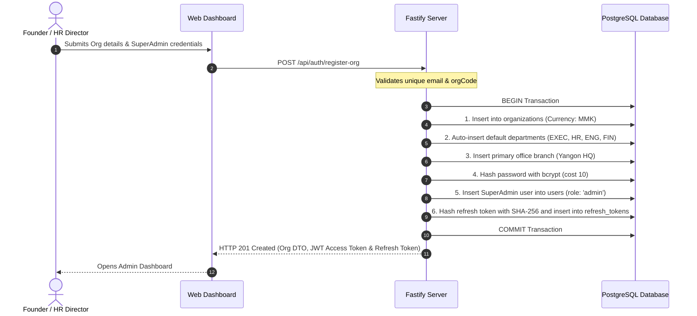
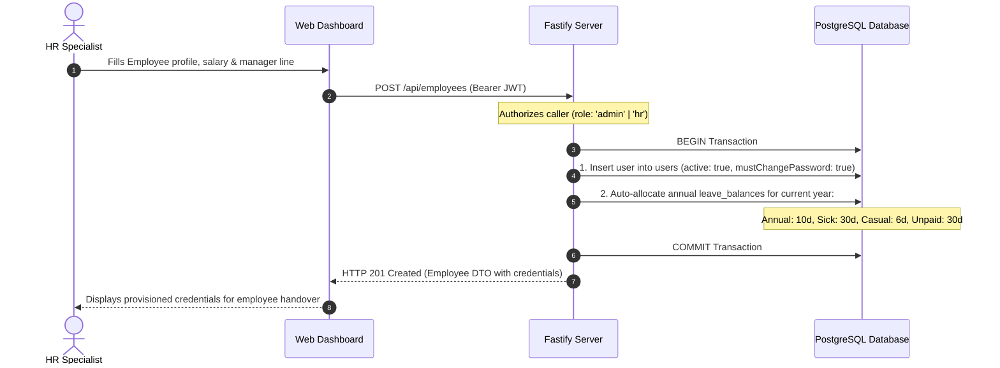
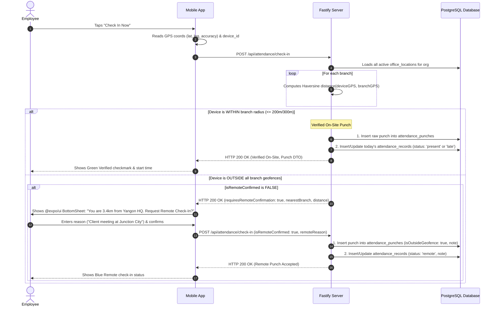
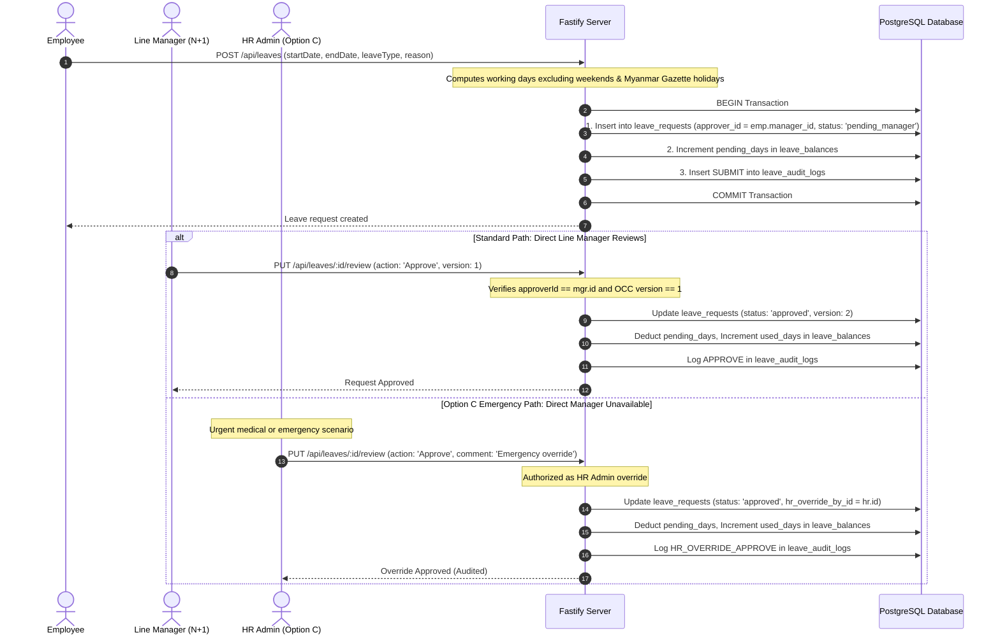

# Omni HR Architecture & Operational Workflow Specification

> **Document Status**: `APPROVED & CONFIRMED ENTERPRISE BLUEPRINT`  
> **Target Audience**: Core Engineers, System Architects, QA Automation Engineers, HR Specialists  
> **Scope**: System Architecture, Channel Segregation, Database Design, End-to-End Operational Workflows, Statutory Compliance Algorithms, and Concurrency Protections.

---

## 1. System Overview & Core Constants

| Dimension | Specification | Standard / Enforcement |
|---|---|---|
| **API Server Engine** | Node.js (v20+ / v22 / v25) + Fastify v5 | High-throughput asynchronous event loop with strict JSON serialization |
| **Default Port** | `5050` | Configured via `PORT` in `.env` |
| **Database Engine** | PostgreSQL 16 (Local Docker Container) | Acid-compliant relational database on port `5432` |
| **ORM & Migrations** | Drizzle ORM (`drizzle-orm`, `drizzle-kit`) | Full TypeScript type-safety with atomic transaction management |
| **Standard Currency** | `MMK` (Myanmar Kyat) | Hardcoded across all tables; Dollar (`$`) is strictly prohibited |
| **Statutory Compliance** | Myanmar SSB (Social Security Board) & Income Tax | Automated monthly statutory formulas and salary caps |
| **Working Schedule** | 5-Day Work Week (Monday through Friday) | Excludes Saturdays, Sundays, and Myanmar Gazette Holidays from leaves |
| **Shift Timing** | 09:00:00 to 17:00:00 | 15-minute grace period before clock-in is marked as late |
| **Client Channels** | Web Portal (Admin/HR/Manager) vs Mobile ESS (Employees) | Role-restricted boundaries enforced at HTTP gateway level |

---

## 2. Channel & Security Boundaries

```
┌─────────────────────────────────────────────────────────────────────────────┐
│                       ENTERPRISE WEB MANAGEMENT PORTAL                      │
│            (For Founders, Directors, HR Specialists, Payroll Officers)       │
├─────────────────────────────────────────────────────────────────────────────┤
│  ✓ Organization Self-Registration & Plan Subscription                       │
│  ✓ Tenant Branch / Office Geofence Configuration (Coords & Radius)          │
│  ✓ Department Structure & Reporting Hierarchy Setup                         │
│  ✓ Employee Provisioning & Initial Leave Quota Allocation                   │
│  ✓ Monthly Statutory Payroll Execution (Myanmar SSB & Progressive Tax)     │
│  ✓ Department Leave Audits, Attendance Regularization & Proxy Punching      │
│  ✕ RESTRICTED: General Staff (role: 'employee') are blocked with HTTP 403   │
└─────────────────────────────────────────────────────────────────────────────┘
                                       │
                                       │ API Gateway Boundary (Fastify v5)
                                       ▼
┌─────────────────────────────────────────────────────────────────────────────┐
│                           MOBILE ESS APPLICATION                            │
│                  (For General Employees, Leads & Field Staff)               │
├─────────────────────────────────────────────────────────────────────────────┤
│  ✕ STRICTLY NO Self-Registration / Sign Up Screen                           │
│  ✓ LOGIN ONLY using corporate credentials issued by Web HR Admin            │
│  ✓ Real-Time GPS Geofenced Attendance (Auto-Branch Haversine Matching)      │
│  ✓ Interactive Out-of-Range Remote Check-In / Check-Out Confirmation Dialog │
│  ✓ Leave Application with Working Day Exclusions (Weekends & Gazette Days)  │
│  ✓ Manager Leave Approvals for Direct Subordinates ($N+1$ Hierarchy)        │
│  ✓ Itemized Monthly Payslips & Deductions Breakdown (in MMK)                │
│  ✓ Corporate Directives & Announcements with Read-Tracking Acknowledgment   │
└─────────────────────────────────────────────────────────────────────────────┘
```

---

## 3. Database Design System

The database architecture comprises 28 tables organized into 10 modular relational schema domains:

```mermaid
erDiagram
    organizations ||--o{ departments : contains
    organizations ||--o{ office_locations : maintains
    organizations ||--o{ shifts : defines
    organizations ||--o{ roles : configures
    organizations ||--o{ users : employs
    organizations ||--o{ leave_balances : grants
    organizations ||--o{ leave_requests : processes
    organizations ||--o{ pay_runs : generates
    organizations ||--o{ announcements : broadcasts
    organizations ||--o{ expense_claims : manages

    users ||--o{ refresh_tokens : owns
    users ||--o{ shift_assignments : scheduled
    users ||--o{ attendance_punches : logs
    users ||--o{ attendance_records : daily_summary
    users ||--o{ attendance_regularizations : requests
    users ||--o{ leave_requests : files
    users ||--o{ payslips : receives
    users ||--o{ employee_loans : holds
    users ||--o{ performance_reviews : evaluated
    users ||--o{ disciplinary_records : documented
    users ||--o{ final_settlements : cleared

    roles ||--o{ role_permissions : assigns
    permissions ||--o{ role_permissions : categorizes
    pay_runs ||--o{ payslips : aggregates
    payslips ||--o{ payslip_items : itemizes
    leave_requests ||--o{ leave_audit_logs : audits
    announcements ||--o{ announcement_reads : tracks
```



### Relational Schema Domains
1. **Multi-Tenancy & Global SaaS Root**:
   - `organizations`: Tenant metadata, code, plan tier (`starter`, `standard`, `enterprise`), max employee seat quota, status (`active`, `suspended`, `trial`), and OCC `version`.
   - Platform SuperAdmin accounts operate with `org_id = null`.
2. **Identity & Access Management (IAM)**:
   - `departments`: Hierarchical division with `parent_department_id` and `lead_id`.
   - `users`: Core user entity containing hashed credentials, national IDs (`nrcNumber`, `ssbNumber`), salary metrics, line manager association (`manager_id`), assigned branch, and OCC `version`.
   - `refresh_tokens`: SHA-256 hashed refresh tokens with expiration and revocation flags.
   - `roles`, `permissions`, `role_permissions`: Granular Role-Based Access Control matrix.
3. **Attendance & Spatial Logistics**:
   - `office_locations`: GPS coordinates (`latitude`, `longitude`), circular geofence boundary (`radius_meters`), and activation flags.
   - `shifts` & `shift_assignments`: Shift start/end times, grace period minutes (default: 15 min), and break allocations.
   - `attendance_punches`: Immutable audit ledger logging raw physical punch timestamps, device IDs, GPS coordinates, distance in meters, and mock location detection.
   - `attendance_records`: Aggregated daily attendance summary (`clock_in_time`, `clock_out_time`, `work_minutes`, `status`, `is_regularized`).
   - `attendance_regularizations`: Missed-punch correction workflows submitted by employees and approved by managers.
4. **Leave Management & Public Holidays**:
   - `public_holidays`: Pre-seeded Myanmar Gazette statutory public holidays per calendar year.
   - `leave_balances`: Yearly leave entitlement gauges (`allocated_days`, `used_days`, `pending_days`, `carried_over_days`, `version`).
   - `leave_requests`: Leave applications with date ranges, half-day flags, $N+1$ approver routing, Option C emergency override fields, and OCC `version`.
   - `leave_audit_logs`: Immutable security log tracking all status transitions (`SUBMIT`, `APPROVE`, `REJECT`, `HR_OVERRIDE_APPROVE`).
5. **Myanmar Payroll & Financial Operations**:
   - `pay_runs`: Monthly payroll run records containing aggregated gross, deductions, employer/employee SSB, and tax figures.
   - `payslips`: Individual payslips with masked banking info, net pay in MMK, and PDF download links.
   - `payslip_items`: Itemized earnings and deductions.
   - `employee_loans`: Company advances and loans with automatic monthly installment deduction tracking.
6. **Expense Claims & Overtime**:
   - `overtime_records`: Overtime hour claims with multiplier rates (e.g. 2.0x for weekends/holidays).
   - `expense_claims`: Multi-category reimbursement claims in MMK with receipt attachments and manager/payroll review stages.
7. **Corporate Comms & Directives**:
   - `announcements`: Organizational memos, directives, and policy notices with priority flags (`Urgent`, `Standard`).
   - `announcement_reads`: Per-user read tracking recording exact acknowledgment timestamps.
8. **Talent Lifecycle & Separation**:
   - `performance_reviews`: Quarterly KPI scoring, ratings, feedback, and bonus multipliers.
   - `disciplinary_records`: Incident tracking with severity levels (verbal warning through final warning).
   - `final_settlements`: Offboarding severance, unused leave encashment, outstanding loan deductions, and net clearance in MMK.
9. **Enterprise Resilience**:
   - `idempotency_records`: Request deduplication cache storing response body and status code keyed by `(key, user_id)` with TTL.

---

## 4. End-to-End Operational Workflows

### Flow 1: Organization Creation & Admin Onboarding (Web Only)



1. **Actor**: Company Founder or Managing Director on Web Portal.
2. **Endpoint**: `POST /api/auth/register-org`
3. **Execution Steps**:
   - Client sends: `orgName`, `orgCode`, `adminName`, `adminEmail`, `adminPassword`, `taxId`, `phone`, `address`, `officeName`, `officeLat`, `officeLng`, `officeRadius`.
   - Server verifies email uniqueness and checks that `orgCode` is unique.
   - Inside an atomic `db.transaction()`:
     - Generates row in `organizations` with default currency set to `"MMK"`.
     - Automatically creates foundational departments: `"Executive Management"`, `"Human Resources"`, `"Product Engineering"`, and `"Finance & Payroll"`.
     - Provisions primary office branch (e.g. `"Yangon HQ"`) with coordinates and geofence radius.
     - Hashes password using `bcrypt` and inserts primary administrator into `users` (`role: "admin"`, `isOrgAdmin: true`).
     - Issues JWT access token (1 hour) and refresh token (7 days). Stores the SHA-256 hash of the refresh token in `refresh_tokens`.
4. **Security Boundary**: Standard employees cannot access this endpoint.

---

### Flow 2: Employee Provisioning & Initial Quota Auto-Allocation (Web Only)



1. **Actor**: HR Administrator or Org Admin on Web Portal.
2. **Endpoint**: `POST /api/employees` (Protected: `role: 'admin' | 'hr'`).
3. **Execution Steps**:
   - HR inputs employee details: `name`, `email`, `employeeCode`, `initialPassword`, `role`, `departmentId`, `designation`, `managerId`, `baseSalary` (MMK), `allowances`, `nrcNumber`, `ssbNumber`, `startDate`.
   - Server verifies email uniqueness and resolves department name and line manager name.
   - Inside an atomic `db.transaction()`:
     - Hashes `initialPassword` and inserts new employee into `users`.
     - **Auto-Allocates Statutory Leave Balances** for the current calendar year in `leave_balances`:
       - **Annual Leave**: `10.00` days
       - **Medical / Sick Leave**: `30.00` days
       - **Casual Leave**: `6.00` days
       - **Unpaid Leave**: `30.00` days
   - Generates initial audit state and returns employee DTO.
   - HR hands temporary credentials to employee for Mobile ESS login.

---

### Flow 3: Mobile Access & Authentication (Mobile ESS — Strictly No Self-Registration)

1. **Actor**: Employee using the Mobile App (Expo SDK 58).
2. **Endpoint**: `POST /api/auth/login`
3. **Execution Steps**:
   - Employee opens app and sees clean **Login Screen** (strictly no "Create Account" or "Sign Up" links).
   - Enters provisioned `email` and `password`.
   - Server checks:
     - User existence and `bcrypt` password hash match.
     - `user.active === true` (suspended or terminated employees are immediately blocked with HTTP 403).
   - **Platform Guard**: If the login request comes from a Web browser (`x-client-platform: web` or body `client: "web"`) and the user has `role: "employee"`, the server rejects with **HTTP 403 Forbidden**:
     > *"Web dashboard access is restricted to Managers, HR Specialists, and Administrators. Standard staff must use the Omni HR Mobile App."*
   - Server issues JWT Access Token (1h) and Refresh Token (7d).
   - Stores the SHA-256 hash of the refresh token in `refresh_tokens`.
   - Mobile client saves tokens into `expo-secure-store` and opens the Daily Command Center.

---

### Flow 4: Geo-Attendance & Precision Punch



#### The Haversine Precision Distance Formula
The server calculates exact spherical distance in meters between device GPS $(lat_1, lon_1)$ and branch coordinates $(lat_2, lon_2)$:

$$d = 2R \cdot \arcsin\left(\sqrt{\sin^2\left(\frac{\Delta \text{lat}}{2}\right) + \cos(\text{lat}_1)\cos(\text{lat}_2)\sin^2\left(\frac{\Delta \text{lon}}{2}\right)}\right)$$

Where $R = 6,371,000\text{ meters}$ (Earth mean radius).

#### Operational Decision Flow:
1. **Multi-Branch Auto-Matching**: The system iterates over all active organizational branches (Yangon HQ, Mandalay Branch, Naypyitaw Center) and finds the closest branch and exact distance in meters.
2. **In-Range ($\le \text{radius}$)**:
   - Immediately accepted as verified on-site check-in.
   - Status set to `'present'` (or `'late'` if checked in after 09:15:00).
3. **Out-of-Range ($> \text{radius}$)**:
   - Returns `{ requiresRemoteConfirmation: true, nearestBranchName, distanceMeters }`.
   - Mobile app opens native `@expo/ui` BottomSheet dialog informing employee of distance.
   - When confirmed with `isRemoteConfirmed: true` and a reason, accepted as:
     - `status = 'remote'`
     - `is_outside_geofence = true`
     - Associated with nearest branch ID and employee justification note.
4. **Shift & Grace Period Evaluation**:
   - Shift start: `09:00:00`.
   - Grace period: `15 minutes` (up to `09:15:00`).
   - If clock-in occurs at `09:16:00` or later: status is marked `'late'`, and `late_minutes` is calculated:
     $$\text{late\_minutes} = (H - 9) \times 60 + M$$
5. **Dual-Table Storage**:
   - **`attendance_punches`**: Raw physical log entry (immutable audit).
   - **`attendance_records`**: Rollup row for today (`clock_in_time`, `clock_out_time`, `work_minutes`, `status`).

---

### Flow 5: Attendance Regularization & Manager Proxy Punching

#### 1. Employee Regularization Workflow
- If an employee forgets to punch or encounters device battery failure, they submit a regularization request via `POST /api/attendance/regularize`.
- Required fields: `date`, `requestedClockIn`, `requestedClockOut`, `reason`.
- System enforces uniqueness: only one pending regularization request is permitted per date.
- Stored in `attendance_regularizations` with `status: 'pending'`.
- Direct Line Manager reviews via `PUT /api/attendance/regularize/:id/review`.
- Upon approval, the server executes an atomic transaction updating `attendance_records` (`is_regularized = true`, `regularized_by = approverId`, `source = 'manual'`).

#### 2. Manager / HR Proxy Punch Workflow
- Managers and HR Specialists can execute a punch on behalf of field staff or employees without mobile access via `POST /api/attendance/proxy-punch`.
- Requires: `targetUserId`, `punchType` (`check_in` | `check_out`), `branchId`, `reason`, optional `timestamp` and `date`.
- **Object-Level Authorization (IDOR check)**:
  - If caller is a `manager`, `targetUser.managerId` must equal `caller.userId`.
  - Admins and HR Specialists can proxy punch for anyone in the organization.
- Atomically inserts into `attendance_punches` with audit note:  
  `[Proxy Punch by Daw Nandar (HR)] Reason: Field deployment`  
  and updates `attendance_records` with `source = 'manual'` and `is_regularized = true`.

---

### Flow 6: Leave Management & Waterfall Approval Hierarchy



#### Waterfall $N+1$ Line Manager Hierarchy Rules:
1. **Strict Line Management**: When an employee submits a request, `approver_id` auto-resolves to `user.manager_id`. Direct supervisors review day-to-day leaves.
2. **Manager Leaves**: When a manager submits leave, their application auto-routes to their own supervisor (`manager.manager_id`, e.g. General Manager or Managing Director).
3. **Anti-Self-Approval**: Under no circumstances can a user approve their own request (`req.userId === callerId` returns HTTP 403 Forbidden).
4. **Option C Emergency HR Override**:
   - If a direct manager is on leave, traveling, or unreachable in an urgent scenario, an **HR Specialist** or **Org Admin** (`role: 'hr' | 'admin'`) can exercise emergency override authority.
   - The action is immutably recorded in `leave_audit_logs` (`action: 'HR_OVERRIDE_APPROVE'`), capturing the actor's ID and override reason.
5. **Deductible Working Days Calculation**:
   - The system loops through `[startDate, endDate]`:
     - Excludes Saturdays (day 6) and Sundays (day 0).
     - Excludes any date present in `public_holidays` for the organization (Myanmar Gazette holidays).
     - Supports half-day leaves (`isHalfDay: true` evaluates to `0.5` days).
6. **Optimistic Concurrency Control (OCC)**:
   - Every review request must pass the current entity `version`.
   - If a colleague manager has already approved/rejected the request, the mismatched version triggers HTTP 409 Conflict with current version details.

---

### Flow 7: Myanmar Statutory Payroll Engine (All in MMK)

```
┌─────────────────────────────────────────────────────────────────────────────┐
│                       GROSS MONTHLY REMUNERATION                            │
│           = Base Salary + Fixed Allowances + Approved Overtime Pay          │
└──────────────────────────────────────┬──────────────────────────────────────┘
                                       │
                                       ▼
┌─────────────────────────────────────────────────────────────────────────────┐
│                     STATUTORY DEDUCTIONS (MYANMAR SSB)                      │
│  • Maximum Salary Ceiling: 300,000 MMK                                      │
│  • Employee SSB (2%): min(Base × 0.02, 6,000 MMK)                           │
│  • Employer SSB (3%): min(Base × 0.03, 9,000 MMK)                           │
└──────────────────────────────────────┬──────────────────────────────────────┘
                                       │
                                       ▼
┌─────────────────────────────────────────────────────────────────────────────┐
│                 PROGRESSIVE PERSONAL INCOME TAX CALCULATION                 │
│  Annualized Gross Income Tiers:                                             │
│  • 0 to 4,800,000 MMK      :  0%                                            │
│  • 4,800,001 to 10,000,000 MMK:  5%                                         │
│  • 10,000,001 to 30,000,000 MMK: 10%                                        │
│  • 30,000,001 to 50,000,000 MMK: 15%                                        │
│  • 50,000,001 to 70,000,000 MMK: 20%                                        │
│  • Above 70,000,000 MMK    : 25%                                            │
└──────────────────────────────────────┬──────────────────────────────────────┘
                                       │
                                       ▼
┌─────────────────────────────────────────────────────────────────────────────┐
│                         INTERNAL COMPANY DEDUCTIONS                         │
│  • Late arrival & unexcused undertime penalties                              │
│  • Unpaid leave deductions: (Base Salary ÷ 22 days) × Unpaid Days           │
│  • Active company loan repayments (auto-deducted from employee_loans)       │
└──────────────────────────────────────┬──────────────────────────────────────┘
                                       │
                                       ▼
┌─────────────────────────────────────────────────────────────────────────────┐
│                             NET TAKE-HOME PAY                               │
│       = Gross Earnings - SSB Employee - Income Tax - Company Deductions     │
│       (Disbursed strictly in MMK with masked banking details)               │
└─────────────────────────────────────────────────────────────────────────────┘
```

1. **Actor**: HR / Payroll Specialist executes monthly pay run on Web.
2. **Security**:
   - Sensitive salary fields (`baseSalary`, `allowances`, bank account numbers) are redacted for non-financial staff.
   - Individual payslips endpoint `GET /api/payroll/payslips/:id` enforces **BOLA / IDOR protection**: non-payroll staff can strictly only access their own payslip.

---

### Flow 8: Expense Reimbursement Claims

1. **Submission**:
   - Employee submits claim via Mobile ESS (`POST /api/claims`):
     - `title`, `category` (`'Travel' | 'Meals' | 'Medical' | 'OfficeSupplies' | 'Training' | 'Other'`), `amount` (in MMK), `expenseDate`, `receiptUrl`, `notes`.
   - Initial status: `"Submitted"`.
2. **Review & Approval**:
   - Manager or Payroll Officer reviews claim via `PUT /api/claims/:id/review`.
   - Status updates: `"Approved"`, `"Rejected"`, or `"Reimbursed"`.
   - Approved reimbursements can be linked to the next monthly pay run.

---

### Flow 9: Executive Directives & Read-Tracking

1. **Broadcasting**:
   - Managing Director or HR Director issues a corporate directive via Web Dashboard (`POST /api/announcements`).
   - Fields: `authorityGroup`, `authorityCode` (`'MD' | 'HR' | 'ENG'`), `directiveNo`, `title`, `summary`, `fullBody`, `priority` (`'Urgent' | 'Standard'`).
2. **Mobile Read-Tracking**:
   - Directive appears in Mobile ESS **Inbox Tab** with priority indicator dots.
   - When the employee opens and reads the full directive text, the mobile app posts to `POST /api/announcements/:id/read`.
   - Stored in `announcement_reads` with the user ID and timestamp, providing HR with an auditable acknowledgment trail.

---

### Flow 10: SaaS Multi-Tenancy & Tenant Lifecycle Management

1. **SuperAdmin Governance**:
   - Dedicated global platform portal powered by `/api/platform` endpoints.
   - View real-time platform metrics: total organizations, active vs suspended tenants, total employee accounts.
2. **Tenant Provisioning**:
   - SuperAdmin provisions new organization (`POST /api/platform/organizations`) with specific plan limits (`starter: 25 seats`, `standard: 50 seats`, `enterprise: 250 seats`).
   - Auto-generates initial administrative temporary password.
3. **Tenant Suspension & Token Invalidation**:
   - When an organization is suspended via `PATCH /api/platform/organizations/:id/status`, the server immediately invalidates and deletes all active `refresh_tokens` for every user within that organization, terminating active sessions immediately.

---

## 5. Architectural Quality Standards & Concurrency Guarantees

| Mechanism | Implementation Detail | Purpose |
|---|---|---|
| **Optimistic Concurrency Control (OCC)** | Sequential integer `version` incremented on updates: `version = sql`\`${users.version} + 1\`` | Prevents dirty writes and race conditions during simultaneous updates by two admins |
| **Enterprise Idempotency** | Fastify `preHandler` & `onSend` hooks caching responses in `idempotency_records` for key `x-idempotency-key` | Prevents duplicate punches, leave submissions, or payments when mobile network reconnects |
| **Atomic Multi-Table Mutations** | All multi-step database writes wrapped in `await db.transaction(async (tx) => { ... })` | Guarantees all-or-nothing rollback on partial failure |
| **SQL Aggregations First** | Native PostgreSQL aggregations using Drizzle SQL operators (`count(case when ...)`, `sum()`) | Eliminates memory leaks and latency caused by in-memory `.filter()` or `.reduce()` on large datasets |
| **SHA-256 Token Protection** | Refresh tokens hashed with `crypto.createHash('sha256')` prior to database insertion | Protects long-term offline mobile sessions in the event of database backup exposure |
| **IDOR / BOLA Prevention** | Mandatory caller ownership checks (`record.userId === request.user.userId`) unless authorized admin | Blocks unauthorized access to peers' payslips, leave records, or claims |
| **Case-Insensitive Search** | Drizzle `ilike` operator applied to text search fields | Ensures seamless employee lookup across varying case inputs in PostgreSQL |
